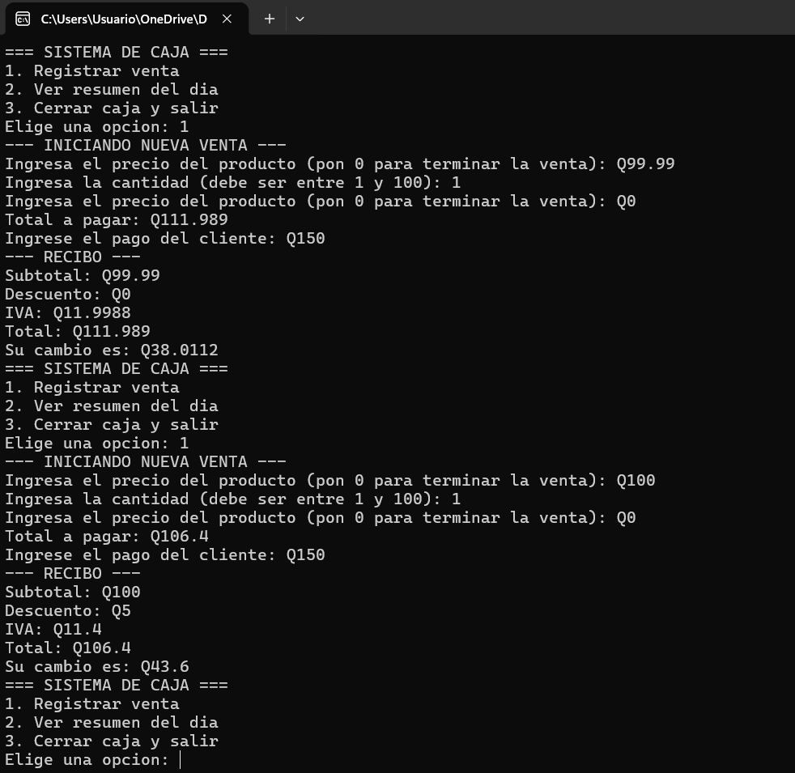
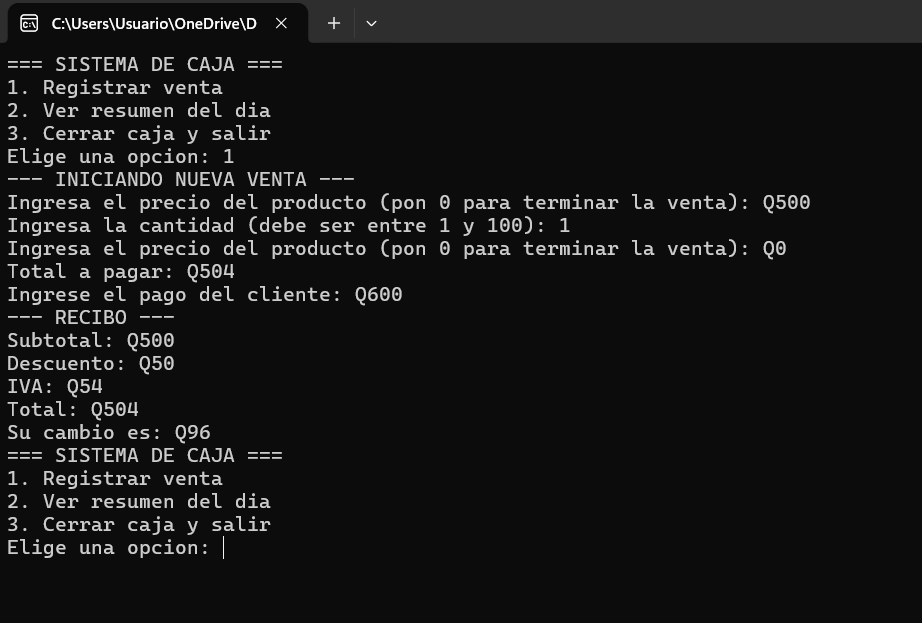
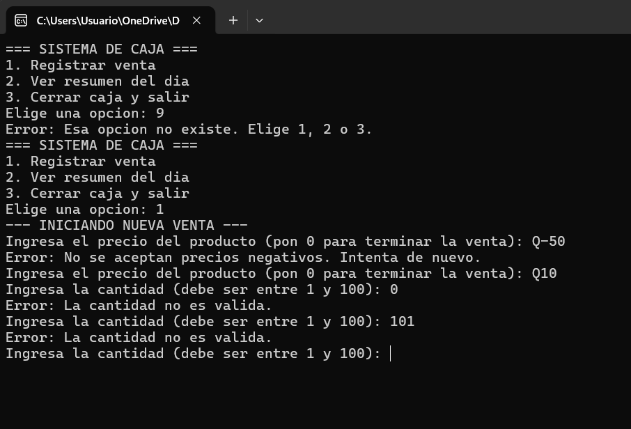
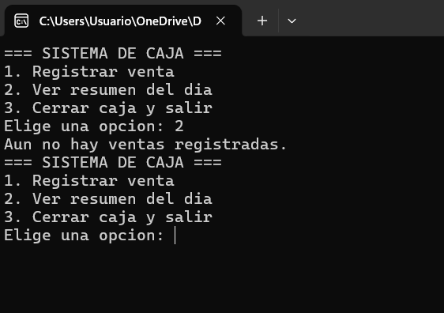
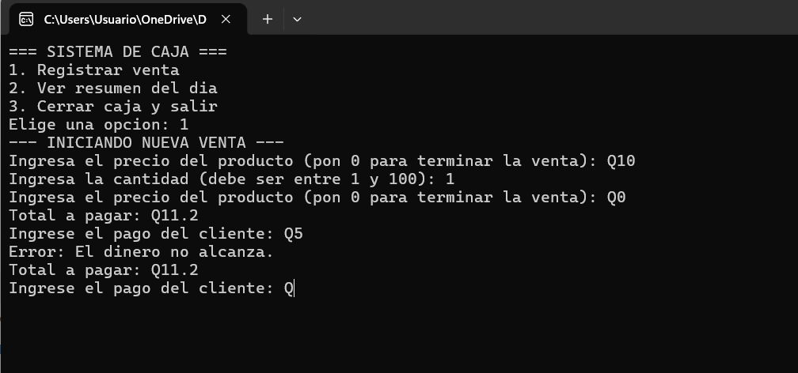

# Sistema de Caja para Tienda 

## Descripción del Proyecto
Este es un programa de consola desarrollado en C++ para gestionar la caja de una tienda. El sistema cuenta con un menú interactivo que permite realizar las operaciones diarias del negocio, tales como registrar ventas individuales, generar un resumen de ventas del día y realizar el cierre de caja. 

## Cómo Compilar y Ejecutar
En la terminal, utilizando el compilador `g++`, ejecuta el comando:
`g++ main.cpp -o caja`

Para iniciar el programa:
* **En Windows:** Escribe `.\caja.exe` en la terminal.
* **En Linux / Mac:** Escribe `./caja` en la terminal.

## Estructuras de Control y Lógica Aplicada
En cumplimiento con los requerimientos del proyecto, se implementaron las siguientes estructuras:
* **Ciclo:** Se utilizó un ciclo `while` principal para mantener el menú activo hasta que el usuario elija la opción de salir (opción 3), y ciclos secundarios para pedir el ingreso de productos hasta que se teclee `0`.
* **Condicional:** Se utilizaron estructuras `if` y `else if` para evaluar el subtotal de la compra y aplicar los descuentos correspondientes (0%, 5% o 10%) dependiendo del monto.
* **Validación:** Se implementaron validaciones dentro de ciclos `while` para evitar el ingreso de opciones de menú incorrectas, precios negativos, cantidades fuera del rango permitido (1 a 100), y para asegurar que el pago del cliente cubra el total.

## Uso de Inteligencia Artificial (Bitácora de Desarrollo)

Para la realización de este proyecto utilicé Gemini de Google como mi tutor de programación. En lugar de pedirle que hiciera el código por mí, le fui haciendo preguntas cuando me trababa. Gemini me respondía dándome varias opciones (algunas muy avanzadas), y mi trabajo fue analizar sus respuestas, rechazar lo que no hemos visto con el ingeniero en clase, y aceptar solo la lógica de control básica (`while` y `if`).

A continuación presento mi diario de 12 interacciones:

### 1. Iniciar el programa en C++ (19/10/2026 - 15:20)
* **Lo que le pregunté:** "¿Cómo hago un menú para mi caja registradora que no se cierre de una vez, sino que vuelva a preguntar hasta que yo elija la opción de salir?"
* **Lo que me respondió la IA (Gemini):** "¡Claro que sí! Para lograr eso te sugiero dos opciones: puedes usar un ciclo `while` que se repita mientras la opción no sea 'salir'. O, si quieres que tu código se vea más profesional, puedes separar el menú creando una función llamada `void mostrarMenu()`. ¿Cuál prefieres probar?"
* **Mi decisión:** **Rechacé** la función `void` porque el ingeniero nos indicó que todo debe ir estructurado de forma básica en el `main`. **Acepté** la lógica del ciclo `while`.

### 2. Mostrar y leer datos (19/10/2026 - 16:10)
* **Lo que le pregunté:** "¿Qué comandos uso para mostrarle el menú al cliente y leer el número que escriba?"
* **Lo que me respondió la IA (Gemini):** "¡Es muy sencillo! Puedes usar `std::cout` para imprimir el texto y `std::cin` para leerlo. Otra forma más antigua, pero que usan muchos programadores, es usar `printf` y `scanf` de la librería de C. ¡Tú decides!"
* **Mi decisión:** **Rechacé** `printf` y `scanf` porque en clase usamos C++ moderno, y también omití escribir `std::` a cada rato porque yo ya había puesto `using namespace std;` arriba.

### 3. Error de archivo en GitHub (19/10/2026 - 17:45)
* **Lo que le pregunté:** "Subí mis archivos pero se me fue un archivo .exe por error y el ingeniero no quiere ejecutables. ¿Cómo lo quito de GitHub?"
* **Lo que me respondió la IA (Gemini):** "¡No te preocupes, tiene solución! Puedes usar el comando `git rm --cached archivo.exe` en tu terminal, o si se te hace más fácil, puedes ir a la página de GitHub, abrir el archivo y hacer clic en el ícono del basurero."
* **Mi decisión:** **Acepté** la segunda opción y lo borré directamente desde la página para no complicarme con más comandos en la consola ese día.

### 4. Error de compilación (20/10/2026 - 10:15)
* **Lo que le pregunté:** "Hoy que abrí el código me tira un error rojo que dice 'expected ;' cerca de la línea 45 y el programa no corre. ¿Qué hago?"
* **Lo que me respondió la IA (Gemini):** "¡Suele pasar! Ese error casi siempre significa que te comiste un punto y coma (`;`). El compilador te marca la línea 45, pero el error suele estar al final de la línea justo anterior. ¡Revisa la 44!"
* **Mi decisión:** **Acepté** la pista, fui a la línea 44, le puse el `;` a mi variable y el programa volvió a compilar bien.

### 5. Cálculo del IVA (20/10/2026 - 11:30)
* **Lo que le pregunté:** "Tengo que sacarle el 12% de IVA a una compra. ¿Cómo lo calculo y hago que salgan solo dos decimales?"
* **Lo que me respondió la IA (Gemini):** "¡Con gusto te ayudo! Para el 12%, solo multiplica tu subtotal por 0.12. Y para fijar los decimales, te sugiero incluir la librería `<iomanip>` hasta arriba y usar el comando `setprecision(2)` antes de imprimir."
* **Mi decisión:** **Rechacé** usar la librería `<iomanip>` porque no la hemos visto en clase y no quería meter código desconocido. Solo usé la multiplicación matemática básica con mis variables `float`.

### 6. Lógica de los descuentos (20/10/2026 - 15:15)
* **Lo que le pregunté:** "Tengo que aplicar un 5% de descuento si la compra pasa de Q100 y 10% si pasa de Q300. ¿Cómo estructuro eso?"
* **Lo que me respondió la IA (Gemini):** "¡Excelente pregunta! Te doy dos opciones: puedes hacer un arreglo (array) con los límites y recorrerlo con un ciclo `for`, o puedes usar la estructura básica `if` y `else if` ordenándolos de mayor a menor."
* **Mi decisión:** **Rechacé** totalmente los arreglos (arrays) porque están prohibidos para este hito. **Acepté** los `if / else if` y yo mismo armé las condiciones en mi código.

### 7. Validar números negativos (20/10/2026 - 16:30)
* **Lo que le pregunté:** "Si meto un precio de -50 quetzales, el programa igual lo suma a la cuenta y me arruina el total. ¿Cómo bloqueo negativos?"
* **Lo que me respondió la IA (Gemini):** "¡Buena observación de seguridad! Puedes usar el comando `break` para detener el programa si detecta un negativo, o usar un bloque `try/catch` para atrapar el error de forma avanzada."
* **Mi decisión:** **Rechacé** ambas opciones. El `break` me cerraba la caja y el `try/catch` es muy avanzado. Yo mismo pensé en la solución: metí un ciclo `while (precio < 0)` para que le tire error y le vuelva a pedir el número.

### 8. Límite de cantidad (20/10/2026 - 17:45)
* **Lo que le pregunté:** "Quiero que la cantidad a vender no pueda ser menor a 1 ni mayor a 100. ¿Cómo pongo dos condiciones juntas en el while?"
* **Lo que me respondió la IA (Gemini):** "¡Para eso usas operadores lógicos! Puedes usar el operador `||` (que significa 'O') así: `while (cantidad < 1 || cantidad > 100)`. Así atraparás cualquiera de los dos errores."
* **Mi decisión:** **Acepté** esta explicación de lógica y la implementé en mi validación de cantidad.

### 9. Problema con el pago del cliente (21/10/2026 - 09:15)
* **Lo que le pregunté:** "Si el total es Q100 y el cliente me paga Q50, el programa me da vuelto negativo. ¿Cómo evito que me paguen menos?"
* **Lo que me respondió la IA (Gemini):** "¡Ese es un error clásico! Puedes usar la función `exit(0)` para que el programa aborte la venta si falta dinero, o puedes hacer otro `while` que no lo deje avanzar hasta que meta un pago igual o mayor al total."
* **Mi decisión:** **Rechacé** el `exit(0)` porque abortar el programa completo es una mala experiencia. **Acepté** hacer un ciclo `while` para la validación del pago.

### 10. Títulos en el README (21/10/2026 - 10:30)
* **Lo que le pregunté:** "Ya terminé mi código de C++. Ahora estoy haciendo el README.md pero quiero que se vea como un reporte, con títulos grandes y viñetas."
* **Lo que me respondió la IA (Gemini):** "¡Qué bien que ya vayas por la documentación! En Markdown usas el símbolo numeral (`#`) para los títulos principales, `##` para subtítulos, y asteriscos (`*`) para las viñetas. También puedes usar código HTML como `<h1>` si quieres personalizarlo más."
* **Mi decisión:** **Rechacé** mezclar HTML en mi documento. **Acepté** usar la sintaxis limpia de Markdown.

### 11. Insertar capturas de prueba (21/10/2026 - 11:45)
* **Lo que le pregunté:** "Tomé 5 capturas de pantalla de mis pruebas, ¿cómo las pego adentro del archivo README para que se vean en GitHub?"
* **Lo que me respondió la IA (Gemini):** "¡Súper! Usa este formato exacto: ``. Asegúrate de que las fotos estén guardadas en la misma carpeta que tu código."
* **Mi decisión:** **Acepté** la instrucción, nombre mis capturas de los casos de prueba y escribí los códigos debajo de cada sección.

### 12. Enlaces rotos de imágenes (21/10/2026 - 13:20)
* **Lo que le pregunté:** "Subí mi README pero las fotos me salen con un ícono de imagen rota. Mis fotos las guardé como 'caso 1.png' con espacio."
* **Lo que me respondió la IA (Gemini):** "¡El problema está en el espacio! En GitHub los espacios en blanco rompen las rutas de los archivos. Quítales el espacio (por ejemplo: `caso1.png`) para que coincidan exacto."
* **Mi decisión:** **Acepté** la pista. Fui a mis archivos, renombré los 5, actualicé mi *commit* y finalmente logré que todas mis fotos cargaran a la perfección.

## Casos de Prueba (Resultados y Capturas)

A continuación se documentan los 5 casos de prueba mínimos solicitados:

### 1. Venta de Q99.99 (sin descuento) y venta de Q100.00 (límite del 5%)

### 2. Venta de Q500.00 (límite del 10%)

### 3. Cantidad 0, cantidad 101, precio negativo y opción de menú "9"

### 4. Resumen del día sin ventas registradas

### 5. Pago menor al total
